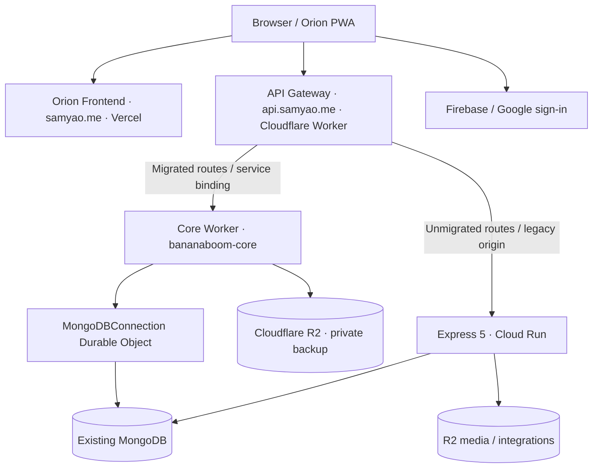

# Orion API — Cloudflare migration

Orion is the API and personal-data backend for [samyao.me](https://samyao.me), a public digital garden plus the private Captain's Cabin. **This is a hybrid production system undergoing a controlled migration to Cloudflare Workers; it is not yet Cloudflare-only.**

**Architecture:** [docs/ARCHITECTURE.md](docs/ARCHITECTURE.md) · **Cutover / shutdown checklist:** [docs/CLOUD-RUN-RETIREMENT-READINESS.md](docs/CLOUD-RUN-RETIREMENT-READINESS.md) · **R2 backup acceptance:** [docs/WORKER-PRIVATE-BACKUP.md](docs/WORKER-PRIVATE-BACKUP.md) · [Frontend repository](https://github.com/orion-ai-club/orion-frontend)

## Production topology (verified 2026-11-07)



**Browser API address:** `https://api.samyao.me`. Core Worker has no public workers.dev endpoint; the API Gateway uses a Cloudflare Service Binding. The old Cloud Run service **is still required**, and some Worker read failures safely fall back to it. The frontend remains on **Vercel** as of this review, **not Cloudflare Pages**. The target is Cloudflare-native **backend APIs only**: retain the existing Vercel frontend and remove Cloud Run/containers.

### Production route ownership

| Surface | Current production behavior | Status |
| --- | --- | --- |
| Public homepage, posts, projects, tags, menu, photos, résumés | Gateway → Core for explicitly approved GET paths, with read-only fallback where implemented | Migrated subset |
| Public comments GET / article likes, selected private post reads | Implemented Worker paths subject to routing and permission rules; verify per route | Partial |
| Profile, Todo and footprint GET | Worker implementations exist; global cutover flags are `0`; explicit canaries only | **Not globally cut over** |
| Article create/update/delete | Transactional Worker implementation with idempotency; normal cutover flag `0` | **Not globally cut over** |
| Database `POST /api/backup/database` | Gateway → Core → MongoDB snapshot → private R2 | **Production cutover complete** |
| Public résumé PDF | Gateway Browser Run; `PDF_BROWSER_CUTOVER=1` | Cut over |
| Login / registration / Google OAuth / sessions and admin writes | Mostly Cloud Run | **Blocking retirement** |
| Second Brain REST + MCP | Native Mongo read, private R2 encrypted sync and OAuth grant/refresh code staged behind disabled canaries; normal traffic still Cloud Run | **Not globally cut over** |
| Personal writes, R2 upload/asset management, AI tools/history | Cloud Run for unmigrated paths | **Blocking retirement** |
| Todo reminders | Core Cron code exists but `TODO_REMINDERS_ENABLED=0`; old GCP job paused | **Not activated** |
| Human chat and old Stripe checkout | Gateway returns HTTP 410; AI chat history is retained | Intentionally retired |

The Gateway controls the exact route allowlist and feature flags in `cloudflare/orion-api-gateway/src/index.js` and `wrangler.toml`. **Do not mistake an implemented Core endpoint or a passing canary for a globally enabled route.**

### Production backup milestone

On 2026-11-07, `BACKUP_R2_CUTOVER=1` was deployed and the normal authenticated *Backup to Cloud (R2)* button succeeded without a canary header. Independent R2 reads verified **32/32 SHA-256 data parts**, **7,220,817 bytes**, **36 collections** and **1,271 documents**. An isolated local MongoDB Replica Set restored all **1,271 documents** and checked **65 secondary indexes**. The production database was not modified during restore. See [backup runbook](docs/WORKER-PRIVATE-BACKUP.md).

## Product scope and decisions

**Retain:** public journal/portfolio/comments, private login and permissions, personal notes, Second Brain/MCP, AI apps and AI conversation history, photo media, footprints, fitness, Todo, period tracking, menus, private data export/recovery and necessary scheduled tasks.

**Retire:** human group/private chat and Socket.IO presence, obsolete Stripe checkout/subscriptions/webhook endpoints, unused PDF generation in Express (once replacement acceptance is complete). Keep existing personal data; do not delete collections just because an endpoint is retired.

**Non-goals:** moving MongoDB to D1, adding a container or Cloud Run compatibility service, replacing user identity with a new provider, making private R2 backups publicly accessible, moving the existing Vercel site to Pages, or deleting the owner-authored historical Express source.

## Repository layout

```text
cloudflare/
  orion-api-gateway/         Custom-domain API gateway; route ownership and cutover flags
  bananaboom-worker/         Cloudflare Core Worker, MongoDB DO, R2 backup, Cron
  orion-ai-gateway/          Separate Workers AI integration
config/ middleware/ models/  Existing Express/Mongoose auth and data structures
routes/ services/ socket/    Cloud Run compatibility code still needed by unmigrated features
tests/                      Legacy integration tests
scripts/                    Migration and independent private R2 restore verifier
docs/
  ARCHITECTURE.md           Current vs target design, trust boundaries and remaining blockers
  CLOUD-RUN-RETIREMENT-READINESS.md
  WORKER-PRIVATE-BACKUP.md
```

## Development and verification

Legacy Express backend: Node.js 22+, pnpm 9+, MongoDB. Install using `pnpm install`, run `pnpm dev`; do not commit local `.env`, secrets, production database connections or downloaded backup objects.

```bash
# Core Worker tests (Node.js 24 runtime in current WSL)
node --test cloudflare/bananaboom-worker/tests/*.test.mjs

# Gateway routing, security and migration tests
node --test cloudflare/orion-api-gateway/*.test.mjs

# Validate the deployment config without changing live routes
cd cloudflare/orion-api-gateway
npx wrangler deploy --dry-run
```

Private backup verification:

```bash
node scripts/verifyorionr2restore.mjs db-backups/<verified-backup-id>/manifest.json
```

The verifier uses authenticated read-only private R2 CLI access, validates every part's checksum, restores solely to an ephemeral localhost `orion_restore_test_` database and cleans up. **Backup data must never be committed, logged, placed in public R2 or checked into a CI artifact.**

## Deployment / production safety

- `api.samyao.me` is a Cloudflare custom domain served by `orion-api-gateway`; `BANANABOOM_CORE` is an internal Service Binding.
- Migrated authentication checks require verified JWT signatures, **live MongoDB sessions**, current role/permissions and owner-scoped queries. A browser-supplied canary header must not grant authorization.
- Never automatically replay a **write, backup or delete** on Cloud Run after a Core Worker failure; the first attempt may already have committed.
- Cloudflare Workers Cron dispatches the post notification outbox; Todo reminders remain disabled until their migration is verified without flooding overdue notifications.
- The legacy Cloud Run source still contains unported routes; do not disable its service or delete its database/image until [the shutdown gate](docs/CLOUD-RUN-RETIREMENT-READINESS.md) has passed.
- Keep secrets in Worker/Cloud Run secrets. The production private R2 backup bucket `orion-private-db-backups` must remain without a public domain.

## One end-state, not endless isolated PRs

The next delivery should be treated as **one integrated Cloud Run retirement milestone**, not as a succession of individually celebrated canary flips. Its definition of done is:

1. Build a route/method/auth ownership inventory (including frontend network calls, Second Brain clients, webhooks and scheduled jobs), and explicitly classify each as keep / retire / replace.
2. Implement remaining retained owner-facing auth, private CRUD, media, Second Brain/MCP and AI paths on Worker/DO/R2, preserving existing data and user sessions; wire frontend to the final endpoints.
3. Confirm complete backend parity for retained flows, recovery and observability; keep the existing Vercel frontend, URL and build/CDN pipeline unchanged.
4. Measure **zero** necessary Cloud Run requests for a representative period including infrequent jobs, rehearse rollback, then disable Cloud Run reversibly. Delete obsolete GCP resources only after the gate succeeds.

**Current assessment:** backup migration is done, **full Cloud Run retirement is not**. This README describes current production, not a claimed future deployment.

**Preserve original source:** Once Cloud Run is retired, leave the historical Express routes/models/services in Git. They are the owner-created codebase, not disposable migration debris. Only remove newly created temporary files or redundant deployed infrastructure.

**Working inventory:** [docs/LEGACY-ROUTE-INVENTORY.md](docs/LEGACY-ROUTE-INVENTORY.md). Password login/logout has a Worker canary (global cutover still OFF); Google/Firebase and MCP OAuth remain legacy until E2E acceptance.

**Second Brain:** [migration design](docs/BRAIN-WORKER-MIGRATION.md) documents read-only Worker canary, old-token compatibility, official MCP transport, tests and outstanding write/OAuth blockers. BRAIN_READ_CUTOVER remains 0.

### Second Brain private-object and OAuth milestone (2026-11-07)

Private originals have been copied **byte-for-byte** from the production GCS memory vault into the independent, non-public `orion-private-memory-vault` R2 bucket: **66/66 encrypted objects, 148,905 bytes, SHA-256 read-after-write verification**, zero GCS deletion, no production MongoDB writes. The Core Worker now has a staged, transactionally idempotent `sync_knowledge` implementation and legacy-compatible OAuth code/refresh grants. Test evidence: **Core 98 pass/1 skip; Gateway 70 pass; two real isolated MongoDB Replica Set tests pass**. **All new write, refresh and MCP write canary switches remain 0**; the original `BRAIN_STORAGE_KEY` is not installed in Core yet, so no production write/refresh has been tested or enabled. Old OAuth/MCP/knowledge writes remain on Cloud Run.

Full scope, storage rollback and the required secure secret setup: [Second Brain write/OAuth migration](docs/BRAIN-WRITE-OAUTH-MIGRATION.md). Keep Vercel, historical Express source, GCS encrypted originals and current MongoDB data.
