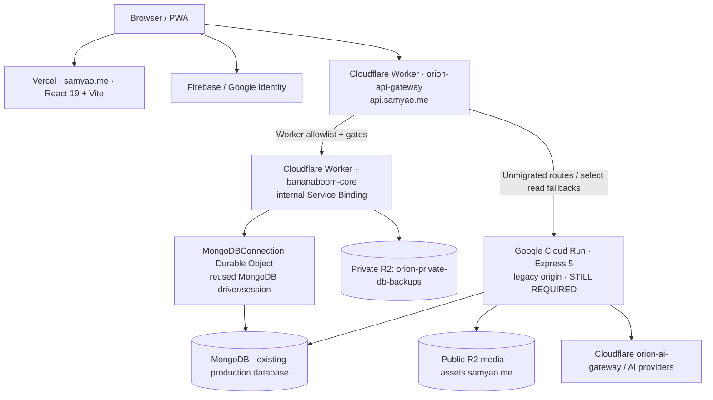
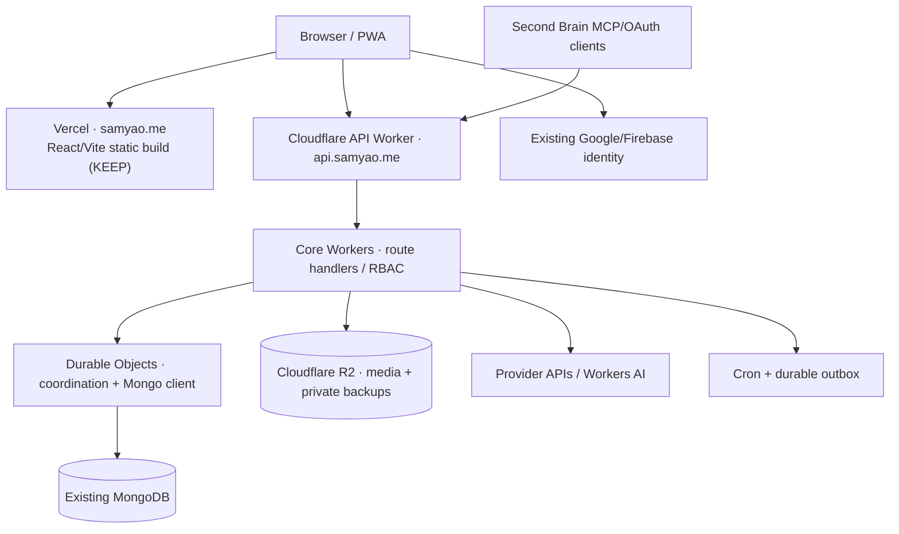

# Orion · Current and target technical architecture

**Source of truth:** production routing source, Wrangler configs and owner-authenticated acceptance results reviewed **2026-11-07**. The website is currently **hybrid**. This document distinguishes deployed features from planned work.

## 1. Current deployment (AS-IS)



Vercel `vercel.json` routes local `/api/*` to `https://api.samyao.me/api/*`. The public site **will remain on Vercel**; migrating its CDN is outside project scope. The Gateway's `ORIGIN_URL` points to the old Cloud Run backend. The production Core Worker is deliberately not exposed under a public workers.dev route.

**Edge security:** explicit route ownership, rate limits, CORS and security headers, restrictive Worker Service Binding. Legacy `x-orion-edge-secret` protects the old origin; it is not a replacement for user JWT / session / RBAC. Write endpoints must be idempotent or fail closed, never dual-executed.

## 2. Target backend deployment (TO-BE: NOT LIVE)



**No Cloud Run / no container / no GCP Scheduler dependency** in the final target. MongoDB remains the source of truth; R2 stores media and **private** recoverable EJSON snapshot backups. No D1 conversion is required or implied. Existing Google/Firebase identity flows must survive; changing frontend hosting alone does not migrate auth or API.

## 3. Actual route ownership and toggles

Current `cloudflare/orion-api-gateway/wrangler.toml`:

| Control | Production value | Meaning |
| --- | --- | --- |
| `BACKUP_R2_CUTOVER` | **1** | Normal authenticated backup uses Core + private R2 |
| `PDF_BROWSER_CUTOVER` | **1** | Public résumé PDF uses Gateway Browser Run |
| `PRIVATE_POST_READ_ROLLOUT_PERCENT` | **100** | Eligible JWT private list reads may use Core; not every auth variant |
| `ARTICLE_WRITE_CUTOVER` | **0** | Regular article writes remain legacy; only explicit guarded canary may target Core |
| `PROFILE_READ_CUTOVER` | **0** | Signed-in parity passed in admin browser, but default remains legacy |
| `TODO_READ_CUTOVER` | **0** | Default remains legacy |
| `FOOTPRINT_READ_CUTOVER` | **0** | Default remains legacy |
| `FOOTPRINT_DETAIL_CUTOVER` | **0** | Default remains legacy |
| `TODO_REMINDERS_ENABLED` | **0** (Core Worker) | Native Cron exists, Todo dispatch disabled |

Some public GET paths route to Core; the Gateway may read-fallback to Cloud Run on failure. Explicit canaries are **not** authorization. The Gateway returns `410` for obsolete human chat and old Stripe checkout endpoints; it preserves AI chat history under `/api/chat/ai`. Dangerous shared-secret reset endpoints are retired. A source-level owner-scoped fix for old footprint detail methods is **not proof** that the live Cloud Run revision contains it; verify production independently.

## 4. Key runtime boundaries

| Component | Responsibilities | Must not do |
| --- | --- | --- |
| Frontend (currently Vercel) | React 19, Vite, PWA, private UI, login UI, calling API custom domain | Store server secrets or select arbitrary upstream |
| API Gateway | Route dispatch, allowlist, rate-limit, auth carrier forwarding, security headers, retire old routes | Silent replay of mutations or fallback from owner-restricted writes |
| Core Worker | Business handlers, permission enforcement, BSON/JSON serialization, DB backup and eligible reads/writes | Rely only on caller-provided role or canary flag |
| MongoDB DO | Reuse MongoDB connections, coordinate privileged backup and scheduled outbox | Expose direct public DB access |
| MongoDB | Current document source of truth (accounts, journals, records, sessions, Second Brain) | Be dropped/migrated to D1 without separate approval |
| Private R2 | Bounded EJSON NDJSON snapshot chunks, SHA-256 manifest | Public domain or public media bucket |
| Cloud Run (legacy) | Still-hosted unported auth, integrations, writes, personal and AI functions | Be shut down before remaining routes and recovery are verified |

### Backup safety and accepted restore (2026-11-07)

Normal POST `/api/backup/database` now uses the Core Worker; the admin-triggered non-canary backup produced manifest `db-backups/2026-11-06T20-37-47.152Z-7838345f/manifest.json`. Independent read-only Wrangler CLI fetched the actual private R2 objects: **32/32** per-chunk SHA-256 and exact bytes passed, total **7,220,817 bytes**. An ephemeral local MongoDB Replica Set restored **1,271 records in 36 collections**, with **65 secondary indexes** verified; exit code 0. An earlier canary also passed. No production DB writes were made by restore. See `docs/WORKER-PRIVATE-BACKUP.md`.

Backup is bounded: **48 MiB Worker staging**, 16 MiB per EJSON document, 50-second database snapshot limit, 120-second total request budget. Oversize aborts; a failed backup must never appear complete. Larger datasets will require a separate safe backup path rather than silently raising memory/time caps.

## 5. Explicit remaining migration work (the retirement critical path)

| Workstream | Must preserve / produce | Production gate |
| --- | --- | --- |
| Identity / OAuth | Login, Google/Firebase callback, verification/password recovery, sessions, RBAC, owner / super-admin access | Real-browser login, refresh, logout, role downgrade, expired-token and denial tests |
| Second Brain / MCP | MCP discovery/tools, OAuth lifecycle, sync, import/export, encrypted/personal knowledge, user-owned memory and data | Existing MCP client reconnection and write/read/restore parity, no token loss |
| Owner CRUD | Todo, footprints, fitness, photos, period, menus, admin content, private journal and comments | Cross-account isolation, auth matrices, mutations with idempotency, CRUD E2E |
| Media | Authenticated upload, R2 browsing, asset references, large image and file handling | Upload→reference→fetch→delete E2E, no public-private leak |
| AI | Preserved AI apps and `/api/chat/ai`, streaming and provider credentials | SSE/streaming parity, provider failure handling, budget and secret protection |
| Scheduling | Native Cron and notification outbox, paused Todo reminders | No duplicate/delayed flood; old GCP scheduler verified disabled |
| Frontend (keep) | Keep Vercel, existing CDN, build, PWA, SEO and custom domain | Confirm all existing browser paths continue to work against the migrated Workers API |
| GCP retirement | No necessary calls reach Cloud Run, all secrets/callbacks/cron migrated | Production zero-upstream observation + reversible shutdown drill |

Retained functionality must be selected from **actual current frontend calls** and Second Brain clients, not only from Express route definitions. Categorize each API by method, authentication variant, owner permission, data collection, side effects, external callback, target Worker implementation, test and traffic status. Pay special attention to rare administrative functions and background jobs.

### Retirement gate: binary decision

**PASS** only when every required route is Worker-owned or explicitly retired; authenticated and OAuth flows are proven; media and private CRUD E2E work; private R2 backups are restorable; native scheduled jobs are tested; UI continues on Vercel and the API no longer needs Cloud Run; monitoring confirms a representative **zero required Cloud Run traffic** period; and a rollback rehearsal succeeds.

**FAIL today** because Cloud Run is still the default for several critical categories. A Cloudflare API custom domain or successful R2 backup **does not** change that verdict. Keep old Cloud Run service and recovery access until all gates pass.

## 6. Working style for the remaining migration

Treat this as **one integrated delivery with a hard final acceptance gate**, not a long stream of unrelated micro-PRs. Implement behind isolated boundaries and test before changing live routing, but merge the complete, cohesive milestone where practical. Test data/restore must be isolated, never delete unrelated user worktrees. Avoid copying or logging secrets. After acceptance record **one final route ownership table, deployment versions and reversible rollback plan** in this document and README.

Repro:
```bash
node --test cloudflare/orion-api-gateway/*.test.mjs
node --test cloudflare/bananaboom-worker/tests/*.test.mjs
node scripts/verifyorionr2restore.mjs db-backups/<manifest-id>/manifest.json
```

**Current target:** Vercel frontend (unchanged) + Cloudflare API Gateway + Core Workers + Durable Objects + existing MongoDB + R2 + native Cron + preserved OAuth/MCP/provider integrations. **Status:** migration still in progress.

## Explicit owner constraints (2026-11-07)

- Keep the website on **Vercel**, including its global CDN, PWA and prerendering.
- Migrate only the Cloud Run-dependent backend to Cloudflare Workers.
- **Never delete the original Express server directories**; they were written by the owner. Preserve them in source control even after Cloud Run is safely decommissioned.
- Do not declare completion until the production old-origin dependency metric is zero across used routes and infrequent callbacks, with a rollback drill.
- Route inventory is generated by scripts/audit-orion-route-ownership.py and recorded in docs/LEGACY-ROUTE-INVENTORY.md. This is a static lower bound, not a traffic measurement.
